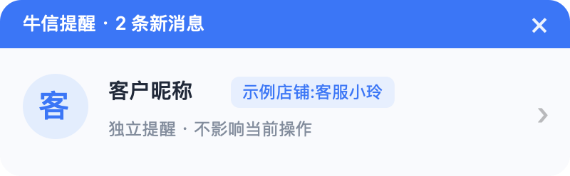

<p align="center"></p>
<h1 align="center">牛信提醒 · Niuxin Reminder</h1>
<p align="center">千牛在后台，消息提醒依然看得见。</p>

独立的 macOS 菜单栏应用，补充千牛聊天窗口被遮挡时不显示的消息提醒。使用 Swift / AppKit 编写，无第三方依赖。**非阿里巴巴官方产品。**



## 下载与使用

从 [Releases](https://github.com/lrylnx/niuxin-reminder/releases/latest) 下载 `NiuxinReminder-1.0.0-universal.zip`，解压并将 **牛信提醒.app** 拖到“应用程序”。支持 Apple Silicon 与 Intel；最低系统版本 macOS 12。

1. 启动千牛并登录，再启动牛信提醒。
2. 在右上角菜单栏找到牛角消息气泡图标。通过“预览提醒样式”检查弹窗。
3. 新消息到达时显示客户昵称、接待账号和头像。点卡片打开千牛；点 × 收起。
4. 菜单栏可暂停、恢复或退出。启动时不会重放历史消息，不自动设置登录启动。

发行包采用本地 ad-hoc 签名，**尚未使用 Apple Developer ID 签名及公证**。下载后 macOS 可能阻止首次打开；确认来源后，可在“系统设置 → 隐私与安全性”按系统提示允许打开。无需关闭系统安全保护。也可从源码构建。

## 功能

- 400 × 124 点紧凑圆角卡片，昵称与接待账号并排展示。
- 独立高层级窗口，切换应用后不隐藏，不抢键盘焦点。
- 客户头像按客户 ID 关联，获取失败显示昵称首字。
- 消息 ID 去重、日志截断与轮转恢复、重复启动检测。
- 单色模板菜单栏图标，适配浅色/深色菜单栏。

## 工作原理与数据

每 0.5 秒读取当前用户千牛日志新增部分：

```
~/Library/Application Support/Aliworkbench/System/log/app.log
```

通过 `ChatService` 的新消息到达事件触发提醒，按消息 ID 关联客户昵称、接待账号；通过 `FetchProfilePortrait` 记录关联头像 URL。头像仅从日志中的 `https://img.alicdn.com/` 地址加载，无需千牛登录凭据。应用不修改千牛、不注入进程、不发送聊天消息、不上传聊天记录、不提供遥测。头像使用内存缓存。

## 已知边界

- 在 macOS 的千牛 **9.97.85** 上实测。不同版本的日志格式、日志开关可能影响功能。
- 消息正文暂不可用；接待账号不是已验证的店铺展示名称。
- 数量表示本工具启动/上次收起后捕获的消息事件，**不是千牛实时未读数**。卡片显示最新客户，多位客户不会展开成列表。
- 在千牛前台也会提醒；暂停期间的事件不会恢复补发，不同步千牛免打扰设置。
- 点击仅打开千牛。指定客户的 `aliim` 跳转在多账号下无法可靠选中接待账号，因此未启用。
- 新客户可能要等千牛获取过头像后才有可用地址。全屏、空间和多屏效果以实际环境为准。
- Universal 包包含 Intel 架构，但当前实测环境为 Apple Silicon。

## 从源码构建

需要 macOS 和 Xcode Command Line Tools / Xcode。

```bash
bash scripts/test.sh
bash scripts/build.sh
open dist/牛信提醒.app
```

构建脚本生成原创图标、Universal 应用、本地签名、ZIP 发行包及 SHA-256 校验文件。没有额外包管理器依赖。

```bash
# 生成不含真实客户信息的样式预览
dist/牛信提醒.app/Contents/MacOS/Reminder --preview assets/preview.png
```

## 许可

[MIT](LICENSE)。图标为本项目原创，生成源文件位于 `scripts/IconGenerator.swift`。
